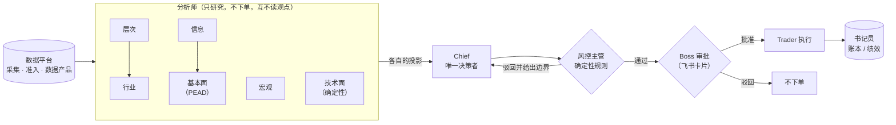
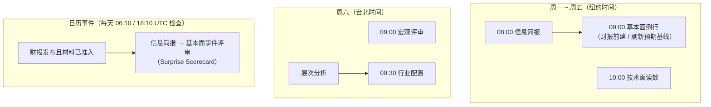

# ats —— 一个「分析师团队 + 唯一决策者 + 人工审批」的美股交易系统

这不是一个自动下单机器人。它是给一个人（下文统一称 **Boss**，也就是你）配的一支
虚拟研究/交易团队：一群 AI「分析师」每天做研究、追踪财报、盯风控，把结论汇总给
唯一的「决策者」，决策者拟好交易建议后**必须经过你在飞书上点一下批准，才会真的
下单**。系统里没有任何路径可以绕开这一下点击。

如果你只想知道"我每天要做什么"，直接跳到 [你每天要做的事](#你每天要做的事)。
如果你想知道"这套系统为什么这么设计"，往下读。

---

## 部署与环境安装（先看这里）

项目统一使用 [uv](https://docs.astral.sh/uv/) 管理根目录的 `.venv` 和 `uv.lock`。**不要在部署机上使用 `pip install` 临时补包**；拉取代码后，只运行对应角色的 `uv sync`，这样所有机器会按锁文件得到相同版本。

```bash
# 首次部署：macOS 系统依赖（FactSet 行业图表的本地 OCR）
brew bundle --file=Brewfile

# 进入仓库；uv 会按指定 Python 创建或更新 .venv
cd /absolute/path/to/auto_stock_trading_agents

# 开发机 / CI：当前已使用的全部功能与测试工具
# memory（chromadb）尚未接入，故意不安装
uv sync --python 3.12 \
  --extra data --extra broker --extra schedule --extra memory-persist \
  --extra channel --extra dev

# 研究生产机：数据、周度调度、持久化审批；按需加入 broker/channel
uv sync --python 3.12 \
  --extra data --extra schedule --extra memory-persist
uv sync --python 3.12 \
  --extra data --extra schedule --extra memory-persist \
  --extra broker --extra channel       # 需要 IBKR 下单或飞书 webhook 时
```

同步完成后的日常命令保持使用 `.venv`，不需要改成系统 Python：

```bash
source .venv/bin/activate              # 可选；之后可直接使用 ats
ats macro review macro

# 不激活环境也可以，适合 cron、launchd 和脚本
./.venv/bin/ats data factset-status
```

跑测试请用**唯一入口** `./scripts/run_tests.sh`（内部 `uv sync --all-extras` + `uv run pytest`，
pytest 参数原样透传）——它会一次装入全部可选分组，这样基线数字才可复核：
`./scripts/run_tests.sh --check` 只装依赖并校验各分组可导入。基线数字、测量条件与
「环境性失败 vs 业务回归」的判据见 [`docs/TEST_BASELINE.md`](docs/TEST_BASELINE.md)。

检查环境是否完整：

```bash
./.venv/bin/python -c "import ib_async, apscheduler, pandas_market_calendars, langgraph.checkpoint.sqlite; print('environment ready')"
tesseract --version
```

`tesseract` 是系统程序，由 Brewfile 管理；其余 Python 包由 `pyproject.toml` 和 `uv.lock` 管理。当前 `memory` extra 的 `chromadb` 尚未接入，不是部署必需项；只有未来启用向量记忆时才加 `--extra memory`。更新依赖时修改 `pyproject.toml` 后执行 `uv lock`，提交更新后的 `uv.lock`，其他机器再执行相同的 `uv sync`。完整的 FactSet 数据产品和运行手册见 [docs/data/FACTSET_EARNINGS_INSIGHT.md](docs/data/FACTSET_EARNINGS_INSIGHT.md)。

---

## 设计思想

这套系统的每一个结构性决定，背后都是在回答同一个问题：**一个人怎么用 AI 帮自己
管理真实资金，又不把决策权和风控彻底交出去？** 具体落到几条硬性原则：

1. **分析和决策分开。** 系统里有好几个"分析师"角色（宏观、行业、财报事件），
   它们每天产出研究报告、给出交易**建议**，但**没有一个分析师能真的下单**。
   所有建议最后都要汇总到唯一一个"首席"（Chief）那里，由它综合全部信息做出
   最终交易决策。这样任何一个分析师的判断出错，影响的只是"一条输入"，不会
   直接变成一笔交易。

2. **风控是硬约束，不是建议，而且永远排在审批之前。** 六层风控（单票仓位、
   组合杠杆/现金、beta/相关性、回撤、压力测试、财报事件风险）全部是**确定性
   代码**算出来的，不经过任何 LLM 判断，只会削减或拦截交易、不会自己制造交易。
   你在飞书上看到的审批卡片，已经是风控筛过、削减过的版本——你看到的从来
   不是"AI 原始的冲动"，而是"AI 的想法过完风控闸门之后剩下的东西"。

3. **人工审批是全系统唯一的安全阀，没有例外。** 不管交易是"每日收口"自动
   触发的，还是"某只票刚发了财报"触发的，还是你自己手动下的单——**所有
   下单路径最终都汇入同一张决策图，卡在同一个审批点上**。系统里有一个
   `--yes`（自动批准）的开关，但那只用于离线冒烟测试，**实盘环境下绝对不能
   打开**——这等于把审批阀门焊死在"通过"的位置。

4. **确定性代码和 LLM 判断，职责分得很清楚。** 风控阈值、仓位计算、加权打分、
   决策树，这些"数值/规则类"的东西全部是普通代码，可审计、可复现、不会因为
   模型换了一版就悄悄漂移。LLM 只负责"语义类"的判断——读懂一段财报电话会
   在说什么、这次的营收算不算超预期、行业最近有什么重大变化。这条分工线让
   系统的关键数字始终有据可查，而不是"模型说了算"。

5. **零交易是正确的默认结果。** 系统不会为了"今天要有动作"而制造交易。多数
   交易日，Chief 读完全部报告后的正确结论就是"维持不动"——这种情况下它甚至
   不会给你发审批卡，安静的一天不该有打扰。

---

## 系统里的"人"（agent 角色一览）

分析师只研究、不下单，**彼此不读对方的观点**，只共享数据平台上同一份事实。
例外只有两条：层次分析师的结论供行业分析师使用，信息分析师的简报供基本面分析师使用。
只有 Chief 能把全部分析结论汇总成交易决策。

| 角色 | 做什么 | 什么时候跑 | 能不能下单 |
|---|---|---|---|
| **信息分析师**（Information） | 读数据平台已准入的新闻、研报、公告、文章，抽出事实变化和可能的影响，产出信息简报；不给买卖建议 | 工作日 08:00（纽约时间）；财报前后由日历事件唤醒 | 不能 |
| **基本面分析师**（Fundamental，PEAD 是它的分析框架） | **例行模式**：财报前建立"预期基线"（市场隐含预期、核心叙事、关键 KPI、可证伪条件），并按新事实发布预期更新。**事件模式**：财报发布后冻结基线，用实际值对照基线、一致预期、市场隐含预期三方打 Surprise Scorecard | 例行：工作日 09:00；事件：日历确认财报已发布后 | 不能，只出建议 |
| **层次分析师**（Layer） | 按产业链层级（目前是 AI 硬件八层）比较标的强弱，给出证据论证；不给配置结论 | 每周六，行业评审前自动先跑 | 不能 |
| **行业分析师**（Sector） | 基于层次分析，给出行业 / 层 / 标的三级配置（超配、标配、低配、清仓） | 每周六 09:30（台北时间） | 不能 |
| **宏观分析师**（Macro） | 用宏观指标和已准入的政策文档判断 regime、传导路径和风险情景 | 每周六 09:00（台北时间） | 不能 |
| **技术面分析师**（Technical） | 三均线七点评分 + VIX 波动率调节 + 两层保护，给出**建议持有的敞口上限**。确定性代码，不经过 LLM | 工作日 10:00（纽约时间） | 不能，只出建议敞口 |
| **Chief（主理人）** | **全系统唯一的决策者**。汇总全部分析结论、持仓和战绩，产出交易提案或"不行动" | 目前只手动运行（见下文"交易路径"） | ✅ 唯一能产生交易决策的角色 |
| **风控主管**（Risk Officer） | 用确定性规则复算交易后的风险，批准、裁剪或驳回提案；不读分析师观点 | 随 Chief 决策 | 不能，只会削减/拦截 |
| **交易员**（Trader） | 只执行通过风控和你批准的同一版提案，发给 IBKR | 随审批 | 执行已批准的单，自己不判断 |
| **书记员**（Clerk） | 对账、记录订单与成交、绩效和归因；确定性代码，LLM 不能改账本 | 随交易路径 | 不能 |
| **Critic（复盘）** | 季度低频复盘交易日志，区分"决策质量"和"结果质量"，给出可选调整建议，从不自动喂回 Chief | 手动 | 不能 |
| **Boss（你）** | 收到审批卡片，点批准或驳回 | — | ✅ 唯一能真正放行一笔交易的人 |



每一笔意图（不只是成交，被撤单、被拒绝、被风控拦下的也算）在提出时就把计划
（止损、止盈、持有多久、什么条件会推翻判断）先落库，结果出来之后不能再改。Critic
读的就是这份日志：样本不够时直接说"样本不足"，不硬编故事。

完整的架构、数据流和每个角色的输入输出契约见
[`docs/TARGET_WORKFLOW_DATAFLOW.md`](docs/TARGET_WORKFLOW_DATAFLOW.md)。

---

## 一天是怎么运作的

整套系统由三个常驻或定时服务驱动，都交给 launchd 管理（命令和排障见
[运维手册](docs/OPERATIONS.md)）：

| 服务 | 做什么 | 节奏 |
|---|---|---|
| `com.ats.data-refresh` | **数据平台**：采集结构化与非结构化数据、刷新财报日历、FactSet 月末摄入、文档准入 | 每小时一次 |
| `com.ats.phase-e` | **研究调度（Dispatcher）**：按时间表和日历事件运行 7 个研究工作流，产出各分析师的投影；**不进 Chief、不下单** | 常驻 |
| `com.ats.serve` | 处理飞书审批回调 | 常驻 |


研究工作流的节奏（`config/workflow/phase_e_schedules.yaml`）：



- **财报是单独的一条主线。** 财报前 3 天内，基本面例行模式为这一期建立预期基线；
  每个工作日它还会把信息简报里的新事实归为确认、否定、新增或待验证，发布预期更新，
  一直到财报日。数据平台确认财报**真的发布了**（而不是按预测日期猜），事件模式才冻结
  基线、对照实际值打分。日历上两个
  来源说法冲突的事件会被挡住，等你用 `ats events override` 裁决。
- **数据没变就不重算。** 依赖的数据版本未变、投影仍在有效期内时，Dispatcher 直接复用
  上一次的结果，不重复发模型请求。
- **缺数据时宁可不出结论。** 必需的分析失败或过期，运行记为 `incomplete`，可以出
  缺口报告，但不会进入决策。

### 交易路径（目前没有切换）

研究侧已在新路径上运行；**Chief、风控、审批、交易和记账还没有切到新路径**，不会
定时运行。现在 Chief 只在你手动执行 `ats chief run` 时运行，实盘授权锁定。切换交易
路径需要你另行授权。

---

## 你每天要做的事

研究侧全自动，日常你只需要：

- **手机收到飞书审批卡片时，看一眼，点批准或驳回。** 卡片会显示 Chief 的决策和
  理由、风控有没有削减或拦截过；实盘账户的卡片有明显的警示前缀，别和模拟盘搞混。
  （交易路径切换前，只有你手动跑 Chief 时才会出现卡片。）
- **收到飞书告警时处理一下。** 数据产品在发布时和每个分析任务执行前都会检查，不合格时
  该分析不执行并告警，告警里写着哪个分析师、哪个数据产品出了问题。
- **偶尔看一眼分析报告。** 各分析师的报告存成 Obsidian 笔记，落在你配置的知识库目录里。
- **偶尔裁决一次日历冲突。** `ats events candidates` 能看到被挡住的事件。

---

## 我要配置的东西都在哪

| 我想做什么 | 改哪里 |
|---|---|
| **跟踪 / 交易哪些股票** | `config/pead.yaml` 的 `targets:`（可交易）与 `observe:`（只读证据） |
| **某只股票的个性化设置**（上下游、关注的 KPI） | `config/pead/<代码>.yaml` |
| **产业链分层、要验证的命题** | `config/sectors/ai_hardware.yaml` |
| **数据采集任务和频率** | `config/data/schedules.yaml`（数据刷新控制器读取） |
| **研究工作流的时间表** | `config/workflow/phase_e_schedules.yaml` |
| **日历事件唤醒哪些工作流** | `config/workflow/event_routes.yaml` |
| **风控限额** | `config/risk.yaml` |
| **模型与推理配置** | `config/settings.yaml` 的 `llm` 一节 |

配置只声明**范围与治理**（看哪些公司、哪些维度、该由谁来说），**不写语义判断**
（比如"哪个方向算支持"）。含义由模型逐条判读并留下可审计的理由——曾经把方向写进
配置（`supports_when`），实测被打脸：景气里管理层必然扩产，那是对需求的回应，不是反驳。

---

## 常用命令

先激活虚拟环境（每次开一个新终端窗口都要重新做一次这一步）。

> ⚠️ **`.venv` 只有一份，固定在主仓库根目录**：
> `/Users/liuchao/Code/trading/auto_stock_trading_agents/.venv`。
> 在 `git worktree` 或子目录里直接 `source .venv/bin/activate` 会报
> `no such file or directory`，用绝对路径激活即可。

```bash
source /Users/liuchao/Code/trading/auto_stock_trading_agents/.venv/bin/activate
```

激活之后可直接用 `ats <命令>`；不激活时用 `.venv/bin/ats <命令>`。

```bash
# 看系统现在的状态
ats consumer-cutover log             # 数据产品健康状态的变化记录
ats dispatch owner-log               # 研究工作流的负责人与停用/恢复历史
ats workflow runs --limit 20         # 最近的研究运行及结果（complete / incomplete）
python -m ats.data.refresh status    # 数据采集任务的最近状态
ats events upcoming                  # 未来的财报 / 宏观事件
ats events candidates                # 被挡住、等你裁决的日历冲突

# 手动跑一次研究工作流（走 Dispatcher，数据没变时会复用、不重复请求模型）
ats workflow run --task macro-review --scope-kind portfolio --scope-id portfolio
ats workflow run --task sector-review --scope-kind sector --scope-id ai_hardware   # 自动先补跑层次分析
ats workflow run --task fundamental-routine --scope-kind portfolio --scope-id pead-targets   # 自动先补跑信息简报

# 看各分析师的产出
ats macro show macro
ats sector show ai_hardware
ats technical show
ats pead show NVDA                   # 某只票的财报档案：基线、打分

# 决策与交易（交易路径尚未切换，以下均需你手动执行）
ats chief run --channel feishu_bot   # 默认 dry-run，发飞书审批卡；绝不要加 --yes
ats chief show                       # 最近一次决策的完整上下文
ats risk report                      # 当前风控画像
ats trader portfolio                 # 实时持仓
ats trader perf                      # 历史绩效
```

研究工作流的负责人是 dispatcher 时，`ats macro review`、`ats pead prep` 这类旧的手动入口
会报 `caller is not current owner` 并拒绝运行——这是故意的，防止同一份分析被两条路径重复跑。

---

## 注意事项 / 安全红线

这套系统一旦切到实盘账户，**动的是真实资金**，以下这些不是"最佳实践建议"，
是实际踩过坑之后总结出来的硬规矩：

- **`--yes`（自动批准）在实盘环境下绝对不能用。** 飞书审批是唯一的人工闸门，
  这个开关的存在只是为了无人值守的冒烟测试。
- **止损是"声明"，不是真的挂在券商那里的止损单。** 系统里记录的止损价只是
  一个用于事后判断"是否按计划执行"的参考值，**不会**帮你挂真实的 stop 单——
  隔夜跳空的股票上，一个真实止损单反而可能在最坏的价格上被打到。真正的
  风险控制来自六层风控的日常监控 + 你自己的审批判断，不要误以为系统会替你
  自动止损。
- **这台机器需要保持醒着，尤其是财报当晚。** 调度依赖 Mac 在触发时刻不处于
  深度睡眠——虽然系统对"晚醒"设了几个小时的宽限窗口兜底，但最可靠的做法
  还是财报密集期让机器别睡死，或配置好定时唤醒。
- **改了代码要重启常驻进程才会生效。** `com.ats.phase-e`（`ats schedule --phase-e`）
  和 `com.ats.serve` 是长驻 Python 进程，启动时把代码加载进了内存，不重启（比如
  `launchctl kickstart -k gui/$(id -u)/com.ats.phase-e`）它们看不到磁盘上的改动。
- **数据源会降级，但不会让流程崩溃。** 某个行情/基本面/期权数据源连不上时，
  系统会自动跳过或换一个源，但打分质量可能因此打折——如果某只票长期只能拿到
  "降级版"数据（比如新上市不久、覆盖不全的标的），这类分析的可信度要打个
  问号，别无条件信任。
- **别把实盘和模拟盘的审批卡片搞混。** 实盘卡片会有明显警示前缀，账户端口
  和模拟盘也不同——手滑在错的账户上点批准，后果是真实的。
- **数据库文件定期备份。** `var/ats.sqlite`（历史决策/绩效/风控记录）和
  `var/checkpoints.sqlite`（等待审批的暂停态）都不进 git，建议自己定期备份。

---

## 想深入了解实现细节？

这份 README 只讲"这是什么、怎么用、要注意什么"。`docs/` 的结构：

| 位置 | 内容 |
|---|---|
| [`docs/TARGET_WORKFLOW_DATAFLOW.md`](docs/TARGET_WORKFLOW_DATAFLOW.md) | Workflow、Dataflow、Agent 契约与审批链的唯一权威设计（需求条文在 `openspec/specs/`） |
| [`docs/OPERATIONS.md`](docs/OPERATIONS.md) | 常驻服务、每日检查、调度负责人切换与回退、数据刷新、事件日历、首次安装、排障 |
| [`docs/DEVELOPMENT.md`](docs/DEVELOPMENT.md)、[`docs/TEST_BASELINE.md`](docs/TEST_BASELINE.md) | 代码约定、仓库结构、测试入口与基线 |
| [`docs/agents/`](docs/agents/) | 每个角色一份：[信息](docs/agents/INFORMATION_ANALYST.md)、[基本面/PEAD](docs/agents/FUNDAMENTAL_ANALYST.md)、[层次](docs/agents/LAYER_ANALYST.md)、[行业](docs/agents/SECTOR_ANALYST.md)、[宏观](docs/agents/MACRO_ANALYST.md)、[技术面](docs/agents/TECHNICAL_ANALYST.md)、[风控](docs/agents/RISK_SYSTEM.md) |
| [`docs/data/`](docs/data/) | 数据平台：[使用手册](docs/data/STRUCTURED_DATA_USER_GUIDE.md)、[运维](docs/data/STRUCTURED_DATA_OPERATIONS.md)、[开发](docs/data/STRUCTURED_DATA_DEVELOPER.md)、[架构](docs/data/DATA_ARCHITECTURE.md)、[数据源状态](docs/data/DATA_SOURCES.md) 与各来源手册 |
| [`docs/research/`](docs/research/) | 信源调研结论 |
| [`docs/PHASE_F_RETIREMENT_RUNBOOK.md`](docs/PHASE_F_RETIREMENT_RUNBOOK.md) | 旧实现的退役判据（23 条未退役） |
| [`docs/archive/`](docs/archive/) | 历史：各阶段验收与复盘、迁移史、旧设计文档与旧手册。只读，不代表现状 |
