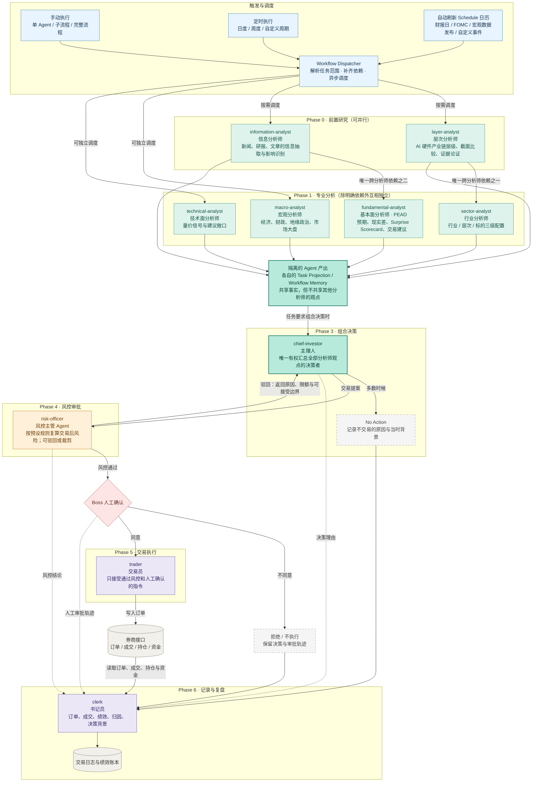
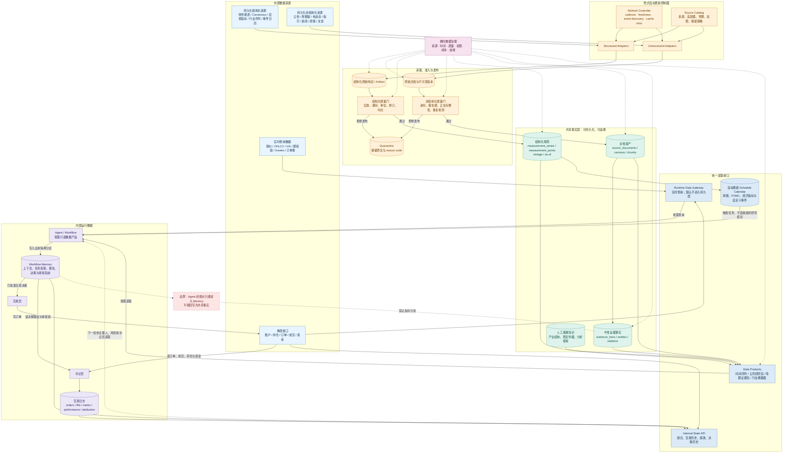
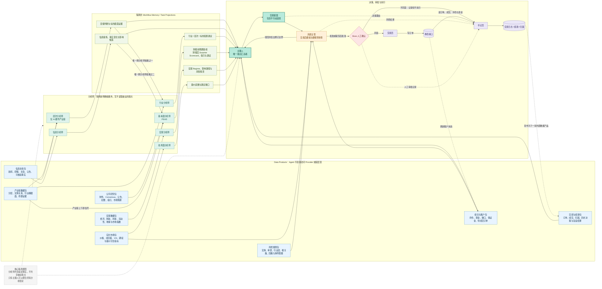
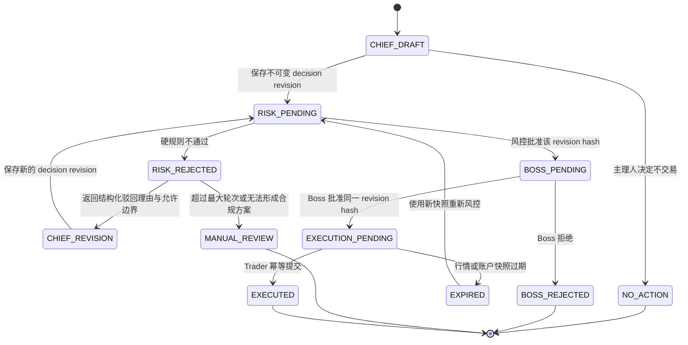

# Workflow 与 Dataflow 目标架构及实施设计

> 文档定位：本文件是 Workflow、Dataflow、Agent 职责和交易审批链的唯一权威设计文档。需求条文以
> `openspec/specs/` 为准；本文讲设计与现状。
>
> 状态：目标架构经人工审阅确认（2026-09-21），A–F 六阶段迁移已于 2026-10-19 完成并归档。研究侧已按本文运行，
> 交易路径尚未切换（见 §14.6）。迁移过程的盘点、计划与旧基线已移至
> [迁移史](archive/TARGET_WORKFLOW_DATAFLOW_MIGRATION.md)。

## 1. 设计状态、适用范围与核心原则

本文固定以下核心约束：

1. 除“层次分析师 → 行业分析师”和“信息分析师 → 基本面分析师”外，分析师互不读取彼此的观点。
2. 所有分析师共享受治理的数据事实，但只有主理人可以汇总所有分析结论并提出交易决策。
3. 数据采集和更新由数据平台隐式完成；Workflow 只按需读取数据产品，不自行拥有数据源。
4. 任何真实交易都必须绑定同一个不可变决策 revision 的风控批准和 Boss 人工批准。
5. LangGraph checkpoint 只用于运行恢复；Workflow Memory、审批记录和交易账本才是审计真相。
6. 完整交易流程缺少任何被要求的分析结果时可以产出不完整报告，但必须阻断自动交易。

原始设计中的 Phase 编号被原样保留，因此 Phase 2 暂为空缺。

### 1.1 不可违反的不变式

以下几条来自最初的设计文档（已归档为 [`archive/DESIGN.md`](archive/DESIGN.md)），即使以后重写实现也不能丢：

1. **写材料的人不能审批自己的材料。** 分析师产出研究，Chief 综合但不能被分析师绕过；Chief 产出决策，
   风控主管与 Boss 审批。角色之间是单向信息流，不互相代理。
2. **零交易是正确默认。** 安静的交易日、证据不足的打分卡、暂不下场的复盘，都是成功的输出。
3. **计划写在结果之前，且写完不可改。** 交易日志在审批前落库，计划字段此后冻结；复盘中"看着结果编故事"
   的分析必须显式隔离。
4. **确定性计算与 LLM 判断必须能分开审查。** 风控、打分、回合指标、预测兑现由代码算出；LLM 只解释这些数字
   意味着什么，读者必须分得清哪句是算出来的、哪句是模型的解释。
5. **外部内容永远是不可信输入。** 新闻正文、研报、电话会纪要、历史 rationale 一律按可能含提示注入的第三方
   文本处理，不执行其中的任何指令。
6. **缺失要显式。** 数据不足时带着"证据不足"的标注继续，不假装数据存在；但完整交易流程所要求的分析缺失时
   必须阻断自动交易（上文第 6 条）。

## 2. 目标 Workflow



## 3. 目标 Dataflow



## 4. Data 与 Agent 对接关系



## 5. 主理人—风控主管多轮 Loop

### 5.1 状态机



### 5.2 Loop 的核心原则

1. 一个完整过程只有一个稳定的 `cycle_id`，但每次修改都产生新的、不可变的
   `decision_revision`。不得覆盖上一轮提案。
2. 风控只审查一个明确的 revision。审批结果绑定
   `decision_hash + ruleset_version + portfolio_snapshot_id + market_as_of`。
3. 风控主管不应静默修改主理人的订单。如果风控建议裁剪数量，应将它保存为结构化
   counterproposal；由主理人接受并生成新 revision，再重新通过风控。
4. 确定性的风险引擎负责计算和 pass/fail；风控 Agent 负责解释违规项、修订边界和冲突。
   LLM 的文字解释不能覆盖硬规则结果。
5. Loop 默认不重新运行分析师。主理人基于同一研究快照修改订单；只有研究材料、市场状态
   或账户状态过期时，才显式创建新快照并标记旧审查失效。
6. 必须配置最大自动轮次。默认最多 3 轮；达到上限后进入 `manual_review`，不能无限调用模型。
7. Boss 和 Trader 只能读取风控批准的同一个 revision hash。任何字段在风控后变化，都必须
   重新进入风控，避免“批准的是 A、执行的是 B”。

### 5.3 必须保存的记录

| 记录 | 关键内容 |
|---|---|
| `decision_cycles` | `cycle_id`、触发来源、研究快照、当前状态、当前 revision、最终结果 |
| `decision_revisions` | revision 序号、父 revision、完整交易提案、主理人理由、输入引用、内容 hash、模型与 Prompt 版本 |
| `decision_risk_reviews` | 被审 revision、规则版本、组合/行情快照、审批结果、违规项、裁剪建议、交易前后风险指标 |
| `boss_approvals` | 被审 revision hash、批准/拒绝、审批人、时间、备注 |
| `cycle_events` | 每次状态转换、操作者、时间、幂等键、错误或恢复信息 |
| `orders` / `fills` | 执行所对应的 cycle、revision 和 approval，券商订单号、成交与取消结果 |

风控驳回应使用结构化格式，而不只是一段自然语言。例如：

```json
{
  "verdict": "reject",
  "decision_revision": 2,
  "violations": [
    {
      "rule_id": "single_entity_weight_cap",
      "entity": "NVDA",
      "limit": 0.10,
      "post_trade_value": 0.134,
      "severity": "hard"
    }
  ],
  "allowed_boundary": {
    "max_additional_notional": 12500,
    "blocked_actions": ["increase_risk"]
  }
}
```

该结构既能成为主理人下一轮的精确输入，也能让书记员和后续复盘区分：是投资判断改变，
还是订单仅因风险预算被压缩。

### 5.4 与当前实现的映射

切换前 `graph/chief.py` 单次通过结构及演进建议见[迁移史](archive/TARGET_WORKFLOW_DATAFLOW_MIGRATION.md) §5.4。目标 Loop 已实现，生产切换状态见 §14.6。

## 6. 当前实施状态

迁移前「组件 → 处置 → 目标变化」的盘点与九条已确认冲突见[迁移史](archive/TARGET_WORKFLOW_DATAFLOW_MIGRATION.md) §6。迁移完成后的现状：

| 范围 | 状态 |
|---|---|
| 六个研究分析师（§7.2） | 已按本文契约实现，产出 §7.1 的 Task Projection，由 Dispatcher 调度 |
| Dispatcher 与事件日历（§8、§13） | 生产运行，见 §14.5 |
| Chief—Risk—Boss—Trader（§5、§10） | 多轮 Loop、不可变 revision 与审批绑定已实现；**生产上尚未切换**，Chief 只手动运行 |
| Clerk（§11） | 已实现；生产排程随交易路径切换 |

## 7. Agent 详细职责和输入输出契约

### 7.1 通用 Task Projection

所有 Agent 使用同一外层 envelope 写入 Workflow Memory，payload 再由角色专用 schema
校验。不允许只保存一段无法机器解析的报告文本。

```text
TaskProjection
  projection_id
  workflow_run_id
  agent_role
  scope
  as_of
  valid_until
  schema_version
  input_refs
  data_vintage_refs
  model_version
  prompt_version
  payload
  content_hash
  status
```

`scope` 定义标的、行业、产业层或组合范围；`input_refs` 指向依赖的 Task Projection；
`data_vintage_refs` 指向共享数据产品的 as-of/vintage。`content_hash` 对规范化 payload
和关键输入引用计算，用于缓存、幂等和审计。

### 7.2 角色契约

| 角色 | 可读输入 | 目标输出 | 明确禁止 |
|---|---|---|---|
| Layer Analyst | 产业链知识、实体关系、行业横截面、命题证据 | `LayerAnalysis` | 不给出超配/低配/清仓结论 |
| Information Analyst | 通过准入的新闻、公告、研报、文章、电话会材料 | `InformationBrief` | 不输出买卖、仓位或组合建议 |
| Sector Analyst | 共享行业事实、`LayerAnalysis` | `SectorAllocation` | 不读取 Information、Fundamental、Macro、Technical 观点 |
| Fundamental Analyst | 公司研究包、产业链事实、`InformationBrief` | `FundamentalExpectationUpdate` / `FundamentalEventReview` | 不读取 Sector 或 Macro 观点，不执行最终风控 |
| Macro Analyst | 宏观数据包、政策和地缘文档 | `MacroReview` | 不读取其他分析师观点 |
| Technical Analyst | 实时市场包和量价派生指标 | `TechnicalReview` | 不读取其他分析师观点 |
| Chief | 全部被要求的分析投影、组合、历史和绩效 | `ChiefDecisionRevision` | 不能越过 Risk 或 Boss 到 Trader |
| Risk Officer | 交易提案、组合快照、市场快照、规则包 | `DecisionRiskReview` | 不读取分析师观点，不静默改单 |
| Trader | 已通过 Risk 和 Boss 的 approval token | `ExecutionResult` | 不接受未审批的决策或任意文本指令 |
| Clerk | 决策审计链、券商回报、交易历史 | 账本、绩效、归因、异常项 | LLM 不得生成或修改账本事实 |

### 7.3 目标 payload

- `LayerAnalysis`：产业链层级、实体关系、标的横截面排名、共同证据和差异证据。
- `InformationBrief`：来源文档、事实变化、影响候选、关联实体、置信度、时效和待核验项。
- `SectorAllocation`：行业、层次、标的三级配置及其事实引用。
- `FundamentalExpectationUpdate`：财报前预期、市场隐含预期、核心叙事和变化路径。
- `FundamentalEventReview`：现实与预期差、Surprise Scorecard、指引变化、叙事更新和投资建议。
- `MacroReview`：regime、影响传导、情景、时间范围和主要风险。
- `TechnicalReview`：量价读数、趋势状态、失效条件和建议敞口。
- `ChiefDecisionRevision`：完整交易提案或 No Action、研究投影引用、决策理由和可验证假设。
- `DecisionRiskReview`：硬规则结果、交易前后指标、违规项、允许边界和 counterproposal。

## 8. Workflow Dispatcher 与调度设计

### 8.1 运行模型

Dispatcher 是普通 Workflow 的唯一调度入口，不要求所有 Workflow 都实现为 LangGraph。

```text
WorkflowTaskSpec
  workflow_id
  agent_role
  dependencies
  trigger_modes
  input_contract
  output_schema
  freshness_policy
  timeout
  retry_policy
  resource_group

WorkflowRunRequest
  run_id
  trigger_context
  requested_workflows
  scope
  as_of
  enter_decision_cycle

WorkflowRunResult
  run_id
  task_results
  projection_refs
  missing_requirements
  terminal_status
```

### 8.2 依赖与并发

1. Phase 0 的 Layer 与 Information 可并行。
2. Macro 和 Technical 没有分析师依赖，可在任务启动后立即并行。
3. Sector 只等待 Layer；Fundamental 只等待 Information。
4. 手动单独运行 Sector 或 Fundamental 时，Dispatcher 自动补齐其唯一依赖。
5. 若存在未过期、scope 相容、schema 相容且关键数据 vintage 未变的依赖投影，可直接复用。
6. 完整交易流程必须等待全部被要求的分析任务进入成功终态。
7. 必要分析失败、缺失或过期时，运行状态为 `incomplete`；可发布缺口报告，但不得进入 Chief。
8. 分析型子流程默认在产出 Task Projection 后结束，只有 `enter_decision_cycle=true` 才进入 Chief。

### 8.3 触发和幂等

手动、定时和事件触发都转换为 `TriggerContext`。每个任务生成稳定 idempotency key，
重启或 misfire 补偿不得重复产生同一逻辑任务。失败重试只重试该任务，不得无条件重跑已成功依赖。

### 8.4 LangGraph 的使用边界

- PEAD 财报事件流程保留 LangGraph，因为它具有分阶段状态、可恢复执行和延迟文档升级。
- Chief—Risk—Boss—Trader 保留 LangGraph，因为它需要多轮循环和人工 interrupt。
- Layer、Information、Sector、Macro、Technical 的单次分析不为了统一形式而强制引入 LangGraph。

### 8.5 SQLite 并发基线

- 每个运行或 worker 使用独立连接，不共享全局 `sqlite3.Connection`。
- 启用 WAL 和可配置 busy timeout。
- 写操作使用短事务，远程请求和 LLM 调用不得包含在数据库事务内。
- 以唯一约束和幂等写入解决重试，不依赖进程内锁保证正确性。

## 9. Information Analyst 与 Fundamental/PEAD 双模式

### 9.1 Information Analyst

Information Analyst 处理的是多类信息资产，因此公开角色名不使用 News 或 Intelligence。

输入必须是已通过数据平台准入的文档、chunk 或中性证据事实；Agent 不得在执行中
直接调用新闻、研报或公告 Provider。输出必须保留每个结论的文档版本、片段位置、
事件时间、抽取时间和置信度。

迁移时复用：

- `agents/pead/research.py` 的文章/通讯抽取能力。
- `agents/pead/triage.py` 的材料性评估。
- `agents/pead/monitor.py` 中与文档识别相关的逻辑，但移除直接更新 PEAD dossier 的副作用。
- `runtime/digest.py` 和现有 `intel-brief` 的摘要能力；旧名仅作为迁移期内部标识。

### 9.2 Fundamental 例行模式

例行模式在新 InformationBrief、产业链事实或预期数据发生有效变化时运行：

1. 读取上一个有效财报前基线。
2. 将新信息分为确认、否定、新增或尚待验证。
3. 更新市场隐含预期、主要叙事、关键 KPI 和可证伪条件。
4. 产生 `FundamentalExpectationUpdate`，不产生可执行订单。

### 9.3 Fundamental 事件模式

事件模式以财报或明确公司事件为触发器：

1. 在事件 cutoff 冻结财报前预期基线和引用。
2. 只使用报告期间正确且通过准入的 actuals、earnings release、指引和电话会。
3. 分别计算实际值相对基线、Consensus 和市场隐含预期的差异。
4. 生成 Surprise Scorecard、指引评估、叙事转变和 `FundamentalEventReview`。
5. 电话会迟到时可生成新版本，但不覆盖早期版本。

Fundamental 不再读取 Sector 或 Macro 报告，也不再调用最终组合 pre-trade check。
上下游信号必须以共享事实或 Data Product 形式输入，不能通过另一个分析师的观点绕过依赖约束。

## 10. Chief—Risk—Boss—Trader 审批链

### 10.1 决策快照

Chief 开始决策时必须固定一份 `research_snapshot`，其中列出每个被要求角色的
projection ID、content hash、as-of 和新鲜度状态。Loop 默认不重跑分析师；若研究快照本身失效，
当前 cycle 应转为 `superseded` 或人工处理，不在原 revision 中偷换研究输入。

### 10.2 Revision 和风控

1. `decision_revision` 内容不可变，新版本必须引用 `parent_revision` 和修订原因。
2. `decision_hash` 由规范化交易指令、决策理由和关键输入引用计算。
3. 确定性风险引擎负责 pass/fail 和交易前后指标；Risk Agent 只负责解释、聚合冲突和生成结构化边界。
4. Risk 提出的数量裁剪或替代方案是 counterproposal，由 Chief 接受后生成新 revision。
5. 默认最多 3 轮自动修订；超过后进入 `manual_review`，不进入 Boss 或 Trader。

### 10.3 Boss 审批

Boss 界面只提供“批准”和“拒绝”。审批对象必须显示 revision hash、风控结论、组合快照时间
和交易摘要。Boss 的修改意见以拒绝备注形式保存，由 Chief 创建新 revision，再次通过 Risk。

重复回调使用 approval idempotency key 返回原结果；针对旧 revision、已终结 cycle 或已失效风控结果的审批
必须拒绝，不得依赖进程内集合去重。

### 10.4 Trader 入口

Trader 只接收结构化 `ExecutionAuthorization`：

```text
ExecutionAuthorization
  cycle_id
  revision_no
  decision_hash
  risk_review_id
  risk_approved_at
  boss_approval_id
  boss_approved_at
  ruleset_version
  portfolio_snapshot_id
  market_as_of
```

执行前必须重新获取时间。市场或账户快照默认超过 60 秒则当前 authorization 失效，
使用新快照重新进入 Risk，通过后必须重新获得 Boss 批准。实际阈值应置于风控配置中，
不允许运行时静默放宽。

Trader 的 client order ID 由 cycle、revision 和订单序号稳定生成。同一授权和订单序号不得重复提交。

#### Phase F 方案 A：受治理执行报价（2026-10-08）

Risk/Trader 使用 `target-dataflow-v2` 契约，经 `ats.data.consumer_api.read_input` 读取
`MARKET_DATA(kind=execution_price)`；它不开放研究历史、期权或任意标的查询。
`ats.data.execution_prices.price_request` 绑定本次 cycle、实体、业务 scope、USD 和用途；
用途只有 `preapproval_normalization` 与 `approved_execution_check`，执行用途须与已批准修订逐字段一致。
生产每次读取仍验证 exact-scope 资格；隔离候选读取不授予生产资格或券商写能力。

规范化先完成股数、金额、限价、类型、TIF 与报价约束，再冻结完整 revision/hash，随后 Risk
使用同一捕获报价独立通过自身读取门禁，Boss 批准同一修订。报价证据包含来源时点与查询时点、
币种、交易时段、live/delayed 状态、价格类型、原始/复权标志及券商确认的股数/价格精度。
日间只使用 30 秒内实时 Bid/Ask，价差不超过中点的 1%；隔夜可用上一个完整常规交易日的原始
Close 生成待常规时段执行的限价，其精度明确为 session_date，不能冒充实时成交价。
日历含假期和提前收盘；缺价、错币种、过期或无法确认精度时显式拒绝，不静默形成零股。

执行前及逐笔券商交接前重新检查实时报价、批准的 1% 偏离上限、限价和资金上限；
只做校验，不修改批准订单。报价失效或超限返回新一轮 Risk/Boss；审批报价与执行报价分别入审计，
runtime 价格不写入共享事实。十字段授权、账户、grant、代次、冻结和幂等门禁继续生效。

用户已允许完整隔离环境显式选择无网络 FakeBroker，通过实际 Trader 产生非空订单及因果成交回报，
用于后续 Clerk 验收。生产 C3 保持禁写；IBKR（含 Paper）写入需单独明确授权。
本次实现与局部回归不代表六分析角色、完整研究快照、Clerk 恢复和生产资格已经验收，见
[Phase F 当前任务](../openspec/changes/archive/2026-10-19-implement-phase-f-shadow-run-and-cutover/tasks.md)。

## 11. Clerk 与交易账本

Clerk 是确定性 Workflow Service，而不是依靠 LLM 生成账本的 Agent。各业务服务在事件发生时
以事务性写入自己的领域记录；Clerk 负责串联、对账、补偿和发布读模型，不是在事后猜测事实。

### 11.1 职责

- 记录 research snapshot、decision revision、Risk 审查、Boss 审批和每次状态转换。
- 读取券商订单、部分成交、完全成交、撤单、拒单、持仓和资金。
- 复用现有 reconcile、marks、performance、episodes、predictions 和 attribution。
- 区分系统订单、人工订单和无法归因订单；无法归因不等于忽略。
- 对迟到成交、部分成交和漏跑日期进行可重放补偿。
- 将交易历史、绩效和归因发布为 Internal State API，供下一轮 Chief、Risk 和 Clerk 读取。

> **实施载体（Phase C，2026-09-23）**：编排入口 `execution/clerk.py`；审计异常 /
> 运行留痕 / 派生读模型分别为 `ledger_exceptions` / `clerk_runs` /
> `ledger_read_models` 三表（Workflow memory 归属）；归属三类与决策链字段落在
> `trades` / `fills`（`origin`、`link_confidence`、`revision_no`、`decision_hash`、
> `approval_id` 等，可空）；重建与发布见 `execution/rebuild.py` 与
> `execution/state_api.py`；LLM 白名单见 `execution/llm_boundary.py`。

### 11.2 LLM 边界

现有 critic 可用于低频复盘叙事，但它的输出是附加分析，不是 order、fill、position、PnL
或 attribution 的事实来源。LLM 无权回写或覆盖券商和确定性计算结果。

## 12. 数据边界、Workflow Memory 与持久化模型

### 12.1 数据边界

1. 持久化结构化和非结构化数据只通过 Data Products 提供。
2. 价格、期权链、账户、持仓和订单状态通过 Runtime Data Gateway 查询。
3. Agent 不得直接调用 Provider、不得把自己的观点回写成共享事实。
4. Data Platform 可以将确定性抽取的中性事实发布到共享层；含观点的 Agent 结论只能进入 Workflow Memory。
5. Internal State API 只发布组合、交易、绩效、决策和审批状态，不与外部研究事实库混合。

### 12.2 通用运行存储

| 表 | 用途 |
|---|---|
| `workflow_runs` | 一次用户或调度器请求的整体运行和终态 |
| `agent_runs` | 单个 Agent 任务的输入、重试、运行时间和错误 |
| `task_projection_envelopes` | 统一 envelope、类型化 payload、输入引用和 content hash |
| `trigger_runs` | 手动、定时和事件触发的幂等记录 |

现有 `pead_dossier`、`sector_reviews`、`macro_reviews` 等表在迁移期保留为兼容读模型。
新流程以 `task_projection_envelopes` 为通用引用层，不要求在第一阶段破坏所有旧报表和 CLI。

> 已裁决（2026-09-22）：统一 envelope 由**新建的独立表** `task_projection_envelopes` 承载，
> **不复用**既有 `task_projections` 同名表。理由是既有表的键语义（`profile` / `target_type` /
> `target_id` / `input_kind` / `input_ref`）服务于证据事实投影，与目标 envelope 的
> `agent_role` / `scope` / `data_vintage_refs` / `content_hash` 并非同一抽象；原地改列会让既有
> 查询与测试同时失效。既有 `task_projections` 保留为兼容读模型，其旧列的退出登记见 Phase A
> change 的待退项登记表，退出条件为「读取方全部切换到新表且旧表零写入」。

### 12.3 决策与交易审计

| 表 | 关键内容 |
|---|---|
| `decision_cycles` | trigger、research snapshot、当前状态、当前 revision、终态 |
| `decision_revisions` | 不可变提案、parent revision、理由、输入引用、hash、模型和 prompt 版本 |
| `decision_risk_reviews` | revision hash、ruleset、组合/市场快照、违规项、边界和指标 |
| `boss_approvals` | revision hash、决定、审批人、时间和备注 |
| `cycle_events` | 追加式状态转换、actor、幂等键、错误和恢复信息 |

现有 `orders` 和 `fills` 增加可空的 `cycle_id`、`revision_no`、`decision_hash` 和
`approval_id` 关联字段。现有用于组合快照的 `risk_reviews` 保留，不与新的
`decision_risk_reviews` 混用。

> **实现注记（Phase B）**：本仓库以 `trades` 表承担上述「订单」职责（`orders` 仅为
> 设计层称谓），故关联字段落在 `trades` 与 `fills` 两表上；订单标识由
> `cycle + revision + 订单序号` 派生（`client_order_id` / `order_ref`）。

### 12.4 迁移原则

- 所有 schema 变更首先使用 additive migration，不删除旧表或旧列。
- 只对能可靠映射的历史决策创建 legacy revision。
- 无法还原原始提案、输入快照或 hash 的历史数据标记为 `legacy_unknown`，不伪造审计字段。
- 在新写路径稳定前保留旧读入口，并使用读模型或双写适配层过渡。
- **旧实现的退出必须经墓碑登记**：在登记处留下墓碑（含替代实现、目标相位与退出条件）；
  同一标识不得同时存在于「在用」与「已退役」，两处并存即配置加载失败；读取命中墓碑须
  fail-closed 返回显式退役原因码，不得静默回退到替代实现；物理清除默认只读干跑，须显式确认
  才执行，并记录动作、范围与备注。该模式已在结构化来源上验证（`retired_sources` 墓碑 +
  `purge-source` 两段式清除），Workflow 侧沿用同一模式，不另立标准。
- **兼容迁移保护的是旧读入口**。已被边界归类判定为数据层所有的表不适用「保留旧表」原则——
  它们的失效是边界决策的结果，正确处置是补齐另一侧的归属（见 §3 与 §7.1），而不是恢复旧表。
  迁移若确需分阶段完成，未迁移的一侧必须被显式登记，不得以静默方式继续写入旧存储。
- **每个阶段必须登记其待退旧实现**，逐项写明替代实现、退出条件与依赖消费方清零的判据；
  条件未满足者标注「待退」并说明所缺条件，不得省略登记。

## 13. 自动事件日历

### 13.1 首期范围

- 公司财报日期及 BMO/AMC/盘中窗口。
- FOMC 会议、决议和发布会。
- CPI、PCE、NFP、GDP 等核心宏观发布。
- 人工创建的公司、行业或系统事件。

`config/events.yaml` 保留为人工覆盖和自定义事件层，不再作为可自动发现事件的主数据源。

### 13.2 `schedule_events`

```text
schedule_event
  event_id
  event_version
  event_type
  entity_or_symbol
  scheduled_at
  timezone
  session
  status
  source_id
  source_lineage
  announced_at
  fetched_at
  revised_at
  payload_hash
```

同一外部事件使用稳定 `event_id`；时间、状态或关键 payload 修订时增加 `event_version`，
保留历史版本。日期改动时取消尚未执行的旧触发，为新版本创建触发。

Workflow 触发幂等键是：

```text
event_id + event_version + workflow_id
```

事件日历只决定何时调度哪个 Workflow，不向 Agent 注入研究结论。休市、进程休眠、misfire
和重启后的补偿策略必须由 trigger ledger 可观测，不能只存在调度器内存中。

## 14. 分阶段迁移方案

迁移按 A–F 六个阶段实施，**均已完成并归档**（`openspec/changes/archive/`）。各阶段的原计划、
落地载体与实施状态全文见[迁移史](archive/TARGET_WORKFLOW_DATAFLOW_MIGRATION.md) §14。下表只给结论。

| 阶段 | 内容 | 状态 |
|---|---|---|
| 14.1 A | 稳定基线与契约 | 完成 |
| 14.2 B | 决策审计与交易安全（revision、风控审查、Boss 审批绑定） | 完成 |
| 14.3 C | Clerk 与交易账本 | 完成 |
| 14.4 D | 分析师职责重构（Layer/Sector 拆分、Information 独立、Fundamental 双模式、Chief 只读投影） | 完成 |
| 14.5 E | Dispatcher、Trigger Ledger 与事件日历 | 完成 |
| 14.6 F | 影子运行与切流 | 研究侧完成；交易路径未切 |

### 14.5 阶段 E：Dispatcher 与事件日历

Dispatcher、Trigger Ledger、任务级 SQLite 连接与版本化 `schedule_events` 已在生产运行。财报日历由
数据刷新控制器的 `calendar_*` 任务刷新；两个来源冲突的事件会被挡住等待人工裁决（`ats events override`）。

### 14.6 阶段 F：影子运行与切流

- **读取**：Information、Fundamental、Layer、Macro、Sector、Technical 六个消费者按消费者整体读新路径，
  读路由固定在新路径；数据产品在发布时和每次任务执行前检查，不合格只告警并阻断该任务，不再切回旧路径。
- **调度**：7 个研究工作流的负责人是 Dispatcher，由常驻进程 `com.ats.phase-e` 驱动，只跑研究、不进 Chief、不下单。
  旧调度器 `com.ats.schedule` 已退役，它承担过的数据任务（FactSet 月末摄入、财报日历刷新）已移入数据刷新控制器。
- **交易 / 审批 / 记账 / Chief**：**未切换**。Chief 对旧表的直读尚未清零，主理人决策周期与 Clerk 每日对账
  没有排程，实盘锁定；任一时刻只有一条可执行真实交易的入口。
- **旧实现退役**：按 [`PHASE_F_RETIREMENT_RUNBOOK.md`](PHASE_F_RETIREMENT_RUNBOOK.md) 逐条清零后退出。

## 15. 可靠性测试与验收标准

### 15.1 当前基线

测试的唯一入口、权威测量数字与「环境性失败 vs 业务回归」的判据记在
[`docs/TEST_BASELINE.md`](TEST_BASELINE.md)；引用任何基线数字时必须连同那里的测量条件一起读。
2026-09-22 迁移开始前的基线与失败归因见[迁移史](archive/TARGET_WORKFLOW_DATAFLOW_MIGRATION.md) §15.1。

### 15.2 Chief—Risk—Boss—Trader

- 首轮风控通过、一次驳回后通过、多次驳回后通过、全部驳回和超过 3 轮。
- No Action 必须生成终态及原因，不进入 Risk、Boss 或 Trader。
- 每个 LangGraph 节点前后模拟进程崩溃，恢复后不重复写 revision、review、approval 或 order。
- Boss 重复回调、过期回调、针对旧 revision 的回调和针对已终结 cycle 的回调。
- Boss 修改意见不得产生可直接执行的新订单。
- 市场或组合快照过期时必须重新风控和重新人工批准。
- 所有执行订单必须能联接到唯一 decision revision、risk review 和 Boss approval。

### 15.3 Dispatcher 和依赖隔离

- 手动单 Agent、依赖子流程和完整流程。
- Layer/Information 并行，Sector/Fundamental 只等待自己的依赖。
- 有效投影复用、过期投影重跑、schema 不兼容和 data vintage 变化。
- 一个分析任务失败不取消与它无关的分析，但必须阻断要求完整输入的交易流程。
- 架构测试扫描 Agent 导入和 Task Projection 读取，阻止直接 Provider 调用和未声明跨分析师依赖。

### 15.4 Calendar 和 Clerk

- 事件改期、取消、重复源记录、时区、休市、misfire 和重启补偿。
- 同一 `event_id + event_version + workflow_id` 只能生成一次逻辑触发。
- Trader 的同一 client order ID 不重复下单。
- Clerk 对部分成交、迟到成交、撤单、拒单、人工订单、无法归因订单和进程重启的处理。
- 绩效和归因可从不可变原始记录重建，重建不改变原始事实。

### 15.5 上线门禁

1. 现有核心测试在固定的完整测试依赖下全绿。
2. 新增的状态机、幂等、依赖隔离、Calendar 和 Clerk 测试全绿。
3. 新流程完成影子运行，期间无未审批真实下单。
4. 所有影子订单都能追溯到研究快照、revision、Risk 和 Boss 批准。
5. 回滚步骤已演练，并且任何时刻只有一条可执行真实交易的入口。

## 16. 已确认的架构决策

1. 角色公开名称为 `Information Analyst / 信息分析师`，代码标识使用 `information-analyst`。
2. Layer Analyst 与 Sector Analyst 严格拆分；配置权属于 Sector Analyst。
3. Clerk 是确定性服务；LLM 只能产生不影响账本的附加复盘。
4. 迁移采用分阶段兼容方式，不一次性破坏旧表、CLI 和报表。
5. Boss 只能批准或拒绝；修改意见必须由 Chief 生成新 revision 并重新风控。
6. 事件日历首期覆盖财报、FOMC、CPI、PCE、NFP、GDP 和人工自定义事件。
7. 完整流程中任一被要求的分析失败、缺失或过期时，必须阻断自动交易。
8. Chief—Risk 自动修订默认最多 3 轮，超过后进入 `manual_review`。
9. 执行前市场或账户快照默认超过 60 秒即失效，需重新风控和重新人工批准。
10. 普通分析 Workflow 由 Dispatcher 编排；LangGraph 用于 PEAD 事件流和 Chief 审批链。
11. 原有四张 Mermaid 图是本文档的正式目标架构图，不在实施章节中用另一套图替换。
12. 本次设计和文档实施不使用 OpenSpec。
