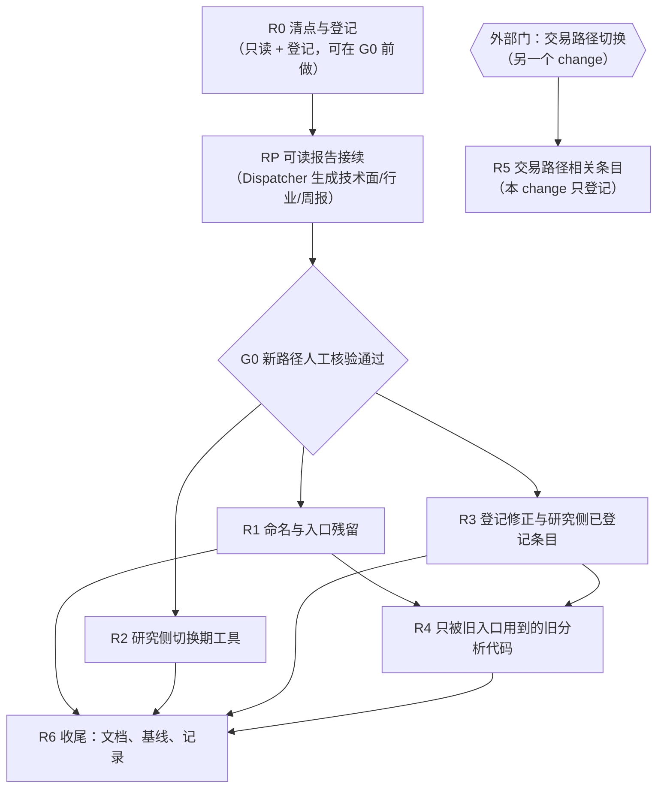

# Design

## Context

动机见 proposal.md。下面只列决定做法的现状和约束。

- **退役登记处**（`config/workflow/legacy_retirement.yaml`）共 27 条：
  - 12 条登记为 retired，其中 4 条有清零证明，8 条的消费方因 `MODULE_TO_ROLE` 缺映射而状态未知；
  - 15 条 pending。
  - 登记只有 `consumers` 与 `target_phase`，没有依赖和门的字段，`ats retirement decide` 也不检查依赖顺序。
- **研究侧已在新路径上运行。**
  - 6 个分析师固定读新路径；
  - 7 个工作流由 `com.ats.dispatcher` 调度；
  - 数据产品在刷新后与任务执行前检查（29c6b4d）；
  - 旧串行调度器已删除（faeac82）。
- **交易路径未切换。** Chief、风控主管、Boss 审批、Trader、Clerk 仍走旧表直读，实盘锁定。
  - Chief 与研究分析师共用读闸门（路由表、资格、边界接线证据），所以这套读路由机制不能先于交易路径拆除；
  - 交易路径切换本身也还要用联合边界、实盘路由、影子账本与隔离验收工具。
- **Dispatcher 的任务适配器直接调用 `agents/*` 模块，不调用 `runtime/cli.py` 里的 `run_*` 函数。**
  - 旧手动入口与新路径在调用链上是分开的；
  - 但旧入口里可能有新路径没有承担的副作用（报告落盘、通知），需要逐个核对。
- **约束：**
  - 历史表、账本、审计记录不删；
  - 台账只增不改；
  - 常驻进程改代码后必须重启；
  - 费用上限在 API key 一侧，退役过程中不得重复发模型请求。

## Goals / Non-Goals

**Goals：**

- 一份完整的待退清单：已登记与未登记的条目都在登记处，每条带依赖与门，依赖可以由机器校验。
- 一个可执行的退役前置门（G0）：你对新路径的人工核验清单和记录方式。
- 一个按依赖排序的执行计划：研究侧 R1–R4 在本 change 内完成，交易路径相关的 R5 只登记。
- 每条退役前后的验证手段都具体到命令或记录。

**Non-Goals：**

- 不切换交易路径，也不改实盘锁定。R5 的执行属于交易路径切换的 change 或其后续。
- 不删除任何历史数据。旧表只停读写入口；需要物理清除时走两段式、默认干跑，且不在本 change 内执行。
- 不改数据刷新任务与数据产品本身，只核验它们。

## Decisions

### D1. 前置门 G0：人工核验清单放在 change 目录，逐项落档

- **形式：** 核验清单与结果写在 `openspec/changes/retire-legacy-and-migration-tooling/verification.md`。它进 Git，可审阅；不放 `docs/validation/`，那里被 Git 忽略。
- **每项写：** 核验对象、核验方式（命令或查看位置）、通过标准、证据引用、核验人、日期、结论（通过 / 未通过 / 不适用及理由）。
- **我只做准备，不代替你签结论：**
  - 我准备清单，并为每项附上可复核的自动证据（命令输出、最近一次运行记录）；
  - 结论由你填；
  - 任一项未通过，依赖 G0 的条目都不执行。
- **为什么人工：** 这是你的要求，也因为退役不可逆。自动检查只能证明"在跑"，证明不了"跑出来的东西对"。
- **替代方案：** 以自动健康检查和测试全绿代替人工核验。没采用，理由同上。

G0 清单范围（R0 阶段生成完整版）：

| 类别 | 对象 | 核验要点 |
|---|---|---|
| Dataflow：非结构化 | ibkr_news、trendforce_news、semianalysis_newsletter、defeatbeta_transcript、defeatbeta_sec_index、sec_official_body、macro_theme_news、ai_hardware_knowledge（共 8 个刷新任务） | 最近一次运行状态、准入文档数与时效、来源 / 版本 / 哈希齐全、已知缺陷（ibkr_news 的 partial、SEC 不可达）是否接受 |
| Dataflow：结构化 | 11 个 consensus_*、company_financials_weekly×3、macro_series、kr/tw 出口、dram 合约价、ramp、openrouter、frontier_ai×5（共 25 个刷新任务） | 最新一期数据、血缘可查、缺口登记 |
| Dataflow：派生 | chain_evidence_daily×4、calendar_*×6、factset_month_end_ingest（共 11 个刷新任务） | 证据条数与时效；日历事件已发布、冲突已裁决；FactSet 月末摄入（11-01 首次） |
| 数据产品 | 信息文档包、公司研究包、产业链数据包、宏观数据包、实时市场包（运行时） | `ats data health` 结论；每个分析师读到的范围正确 |
| Workflow：定时 | information-brief、fundamental-routine、technical-review、macro-review、sector-review（含自动补跑的 layer-review） | 最近一次定时触发 complete；产出投影的内容正确（你看报告）；复用不重复请求模型 |
| Workflow：事件 | 财报计划 → 例行建基线、财报发布 → 事件评审、宏观发布（开关关闭，核验"不触发"） | 至少一次真实财报事件端到端（例如 LRCX 10-21）：基线冻结、三类差异、打分 |
| 运行保障 | 数据产品检查（刷新后、读取前）、飞书告警、任务阻断语义、`com.ats.dispatcher` 重启与启动补跑 | 人为制造一次不合格（隔离环境）或查看真实记录，确认告警与阻断 |
| 运维文档 | OPERATIONS、ARCHITECTURE、角色文档 | 照文档能完成日常检查与手动运行 |

### D2. 登记处扩展：同一份登记，新增类别、依赖与门

- **新字段：** 每条增加 `kind`、`group`、`depends_on`、`gate`。
  - `kind`：`business`（业务旧实现）、`migration_tooling`（切换期工具）、`migration_mechanism`（嵌在运行路径里的新旧路由与资格机制）、`legacy_entry`（旧手动入口）、`naming`（命名残留）。
  - `group`：R1–R5。
  - `depends_on`：前序条目标识列表。
  - `gate`：`G0`，或 `trade_path_cutover` 这类外部门。
- **加载时校验：** 依赖不得成环、不得指向不存在的条目，`gate` 必须是已知值。`ats retirement decide` 增加依赖与门的检查：前序未完成、或门未满足的条目不得判为可退出。
- **G0 的状态：** 以 verification.md 的结论为准，由 `ats retirement gate --show` 只读汇总。
- **替代方案：** 另建一份"迁移工具清单"。没采用，因为两份清单会再次分叉，而现有规格要求退役只有一条合法路径（墓碑登记）。

### D3. 分组与依赖顺序

- **R0** 的只读部分（清点、副作用对照、核验清单）在 G0 之前完成；登记格式扩展与条目写入在 G0 之后做，避免核验发现缺陷后返工。
- **RP** 在 G0 之前完成：报告由新路径生成之后，你核验时才能看到真实报告；它只新增产出，不删任何东西。
- **R1、R2、R3** 之间没有依赖，可以并行，但每批仍单独提交、单独复验。
- **R4 依赖 R1 与 R3：** 旧入口删掉之后，才能判断哪些旧分析代码只被旧入口引用。
- **R5 不依赖 R1–R4**，只依赖交易路径切换。

### D4. 分组清单（R0 逐项核实后写入登记）

已登记条目用登记标识，未登记条目用拟定标识（`migration.*` / `legacy_entry.*` / `naming.*`）。「候选」表示需要 R0 用调用图和运行记录确认后才进入执行。

**R1 命名与入口残留**（门 G0）

| 条目 | 类型 | 替代 | 退役方式 |
|---|---|---|---|
| `naming.consumer_cutover_cli` | 命名 | `ats data health [--consumer]`、`ats data health-log` | 改名；删除 `status`（路由已固定，见 R5） |
| `legacy_entry.research_manual_commands` | 旧手动入口 | `ats workflow run --task <id>` | 删除 `ats macro review`、`ats sector review/layer/crosssection`、`ats technical review`、`ats pead prep/score/monitor/watch/research`、`ats analyst information/fundamental`；保留一段时间的提示桩，说明已退役和替代命令。只读的 `show`/`probe`/`html` 保留 |
| `legacy_entry.research_owner_legacy_mode` | 旧手动入口 | 工作流停用 / 恢复（`ats dispatch pause/resume`） | 负责人只剩 dispatcher 与 paused 两种状态；`owner-switch/owner-rollback` 改名；`workflow_owners.yaml` 的 legacy 默认值去掉 |
| `legacy_entry.evidence_commands` | 旧手动入口 | 数据刷新的 `chain_evidence_daily`（`ats data evidence-observe`）与 Layer 的证据判读 | 只删 `ats evidence observe/collect/articles` 与 `ats sector crosssection`（评审内部已自己算截面，独立持久化的那一遍没有消费者）；**命题治理命令 `ats evidence claims/report/propose/proposals/review/kbreview` 与 `ats sector kbperturb` 保留**（人审批新命题的入口，用户 2026-10-21 确认） |
| `naming.migration_terms_in_docs` | 命名 | — | 文档与帮助文本中的"新路径 / 旧路径 / 切流 / phase"残留 |

**R2 研究侧切换期工具**（门 G0；运行路径之外，只被命令行和测试使用；具体依赖与簇外使用方见 inventory.md 第二节）

| 条目 | 涉及 | 说明 |
|---|---|---|
| `migration.batch_read_cutover` | `workflow/batch_manifest.py`、`read_cutover.py`、`read_deployment.py`；命令 `ats batch`、`ats read`；测试 `test_batch_manifest`、`test_read_cutover`、`test_batch_cli` | 逐批、逐 scope 切流；10-19 登记的 41 个旧失败中的 38 个在这里，另外 3 个属于 `ats cutover`（R5） |
| `migration.schedule_cutover` | `schedule_cutover.py`、`cutover_acceptance.py` 及其测试 | 调度批次切换与验收 |
| `migration.intake` | `intake.py`、`intake_verification.py`、`scoped_intake.py`；命令 `ats intake`；测试 | 接入核验与逐消费者处置 |
| `migration.dispatch_dedup` | `dispatch_claims.py`；命令 `ats dispatch runtime-*`、`ownership`、`ledger`、`executed`、`record-execution`、`rollback-plan`、`rollback-history` | 新旧调度去重；旧调度器已删除。**前置：**`workflow/cutover_wiring.py` 的接线声明里引用了 `dispatch_claims.claim`，先去掉这条声明及 `boundary_evidence` 对应调用点。保留 `owner-*`（改为 pause/resume，见 R1） |
| `migration.analysis_verification` | `analysis_verification.py`、`consumer_disposition.py`、`isolated_entry.py` | inventory.md 已确认无簇外使用，与 `intake_verification` 绑定一起走 |

**R3 登记修正与研究侧已登记条目**（门 G0）

| 条目 | 处置 | 依赖 |
|---|---|---|
| 8 条"登记已退役但未证明" | 补 `MODULE_TO_ROLE` 后重扫；有读取就改回 pending | — |
| `task_projections.legacy_columns`、`evidence_fact_projections.legacy_observation_id`、`layer_verdict.allocation` | 消费方清零后退役：先迁走或删除仅剩的命令行和测试消费方 | 对应 R1 入口先退役 |
| `pead_dossier` | 从待退项中移出，改登记为基本面自有记录：财报前基线存在这里，事件评审读它 | — |
| `macro_reviews`、`technical_reviews`（在用清册中但无条目） | 补登记；消费方是 Chief 时归入 R5 | — |

**R4 只被旧入口用到的旧分析代码**（门 G0；依赖 R1、R3；inventory.md 第三节已逐个核实，范围缩小）

| 条目 | 模块 | 说明 |
|---|---|---|
| `agents.risk_manager` | `agents/risk_manager.py` | 无任何引用，只有 1 个测试 |
| `agents.risk_validator.apply_guardrails` | `agents/risk_validator.py` | 无任何引用，只有 1 个测试；即登记里已有的条目 |
| `agents.pead.monitor` | `agents/pead/monitor.py` | 只被 `ats pead monitor/watch` 用；R1 删命令后进入 |
| `agents.pead.research` | `agents/pead/research.py` | 2026-10-26 增补：迁移期薄代理，只被 `ats pead research` 用；R1 删命令后进入 |

明确**保留**（有新路径或交易路径的生产使用方）：`graph/pead.py`、`agents/pead/{prep,score,report,units,triage,outputs}`、`runtime/digest.py`、`agents/evidence/observer.py`、`runtime/evidence_observe.py`（被 `chain_evidence_daily` 调用）、`agents/sector/{context,structure,rotation}`、`chain/*`、`runtime/server.py`、`graph/checkpoint.py`。

**R5 交易路径相关**（外部门：交易路径切换；本 change 只登记，不执行）

| 类别 | 条目 |
|---|---|
| 已登记 | `chief.legacy_table_direct_reads`、`sector_reviews`、`store.direct_trade_reads`、`legacy_read_models`、`decision_roles.unwired_to_governed_read_api`、`memory.store.legacy_decision_write_path`、`trades.client_order_id.legacy_derivation`、`risk.checks.pre_trade_adapter`、`scheduler.adhoc_journal_jobs`、`performance.legacy_snapshot`、`journal.report.render_ledger` |
| 读路由与资格机制 | `cutover`、`cutover_routing`、`scoped_routes`、`consumer_cutover` 的路由表、`consumer_reads`、`read_windows`、`read_recovery`、`invocation_bindings`、`boundary_evidence`、`cutover_wiring`、`assurance_surface` 与指纹清单 |
| 交易侧切换工具 | `joint_cutover`、`boundary_drill`（含对 `batch_manifest`/`read_cutover` 的引用，需先拆开）、`acceptance_runner/reports/matrix/assertions/disposition`、`paired_business`、`shadow_*`（`shadow_ledger` 还被 Clerk 引用）、`exit_requirements`（被 `data/assurance.py` 引用）、`business_replay_inputs`（被 `consumer_api`、`route_switch` 引用）；命令 `ats cutover`、`ats drill`、`ats shadow`、`ats live drill` |
| 在用旧表 | `macro_reviews`、`technical_reviews`（若 Chief 仍读） |

交易路径切换完成并过观察窗口后，研究分析师与 Chief 读同一新路径，这套机制才能整体收窄成"按 scope 读数据产品"。

### D5. 每条退役的验证（V1–V6）

| 编号 | 时点 | 内容 | 手段 |
|---|---|---|---|
| V1 | 退役前 | 静态无引用 | 调用图：除本批要删的集合外，`src/` 中没有导入或调用；测试中的引用随本批改写或删除 |
| V2 | 退役前 | 运行无调用 | 生产日志与台账：`consumer_read` 日志、`trigger_runs`、`workflow_runs`、命令调用记录中，最近 14 天没有经该条目的调用；没有记录手段的命令行入口，以 G0 核验时你确认不再使用为准 |
| V3 | 退役前 | 门与前序满足 | `ats retirement decide` 检查依赖与门（D2） |
| V4 | 退役后 | 测试 | 受影响测试删除或改写并通过；本批全量测试与基线逐项对照，新失败修复或归因登记（TEST_BASELINE） |
| V5 | 退役后 | 运行 | 重启 `com.ats.dispatcher` 与 `com.ats.serve` 后，下一次定时触发、一次数据刷新、一次日历消费正常完成；`launchctl list` 确认 PID |
| V6 | 退役后 | 历史 | 旧表与台账可读；调用已退役的命令返回明确的已退役提示与替代命令；墓碑与登记一致（`ats retirement` 墓碑检查） |

### D6. 旧手动入口与负责人 legacy 模式一并退役（2026-10-21 用户确认）

- **退役的理由：** 旧调度器删除后，负责人退回 legacy 就意味着"不再定时运行、只能手动用旧命令跑"。它已经不是有意义的回退，反而保留了第二条执行路径。
- **替代：**
  - 停用 / 恢复工作流，规格见 dispatcher-runtime 的新要求；
  - 手动运行统一用 `ats workflow run`。
- **代价：** 如果新路径某个分析出问题，只能修新路径，不能临时改用旧命令。
- **G0 的作用：** 这正是 G0 要先过人工核验的原因。

### D7. 命名：`consumer-cutover` 拆成数据健康命令

- **拆分：** `health`、`log` 移到 `ats data health` 与 `ats data health-log`；`status` 删除。
- **路由表不动：** 底层的路由表与 `consumer_cutover` 模块在 R5 之前保持原样，因为读闸门还在查它。
- **改名留桩：** 改名后旧命令保留一个版本的提示桩。

### D8. 历史与回滚

- 每批一个提交，只删代码、命令、配置与测试，不碰数据，回滚就是 `git revert` 该批提交并重启服务。
- 删除前，把被删命令的用法与最近一次输出样例归档到 `docs/archive/`，便于事后查阅。

### D9. 可读报告由 Dispatcher 路径接续生成（RP，2026-10-21 用户确认）

旧入口里生成可读报告的几项，Dispatcher 路径目前没有：技术面报告（适配器传了 `write_report=False`）、行业报告 / 层级报告 / 可视化页面（`write_reports=False`）、每周产业链证据周报（随旧调度器删除）。宏观周报已补（10-17）。

- **做法（按实际实现修订）：** 数据只在某个任务内部才有的报告，由该任务自己写；需要汇总整次运行或排在评审之后的，在 `run_owned_workflow` 的一次运行结束之后由「报告发布步骤」（`workflow/report_publishers.py`）写。
  - 行业报告、层级报告、层分析页面：行业评审任务内（`write_reports=True`），因为层级报告需要的评估与排名只存在于评审运行过程中，事后无法重建。
  - 技术面汇总报告、每周产业链证据周报：运行结束后的发布步骤。技术面任务是逐标的的，汇总只有运行结束才齐；报告数据取自本次运行发布的投影，因此不含 VIX / VIX3M 的具体数值。
  - 失败记录：发布步骤的失败写进运行返回值的 `reports`；任务内的报告失败只写日志。
  - 技术面：运行结束且有新读数投影时，写一份汇总报告。
  - 行业：行业评审完成后写行业报告、层级报告、可视化页面，再写本周产业链证据周报（顺序沿用旧流程）。
- **约束：** 报告是投影与存档的派生物，生成失败只记录、不改运行状态、不阻断下游；文件一律新版本写入、不覆盖；复用既有投影且没有新发布时不重复生成。
- **替代方案：** 放进各任务适配器，沿用宏观周报的做法。没采用，因为逐标的任务会各写一份报告或写出残缺的汇总。
- **验证：** 手动在隔离环境运行一次对应工作流，看到报告文件；G0 清单里加「可读报告」一项，由你看真实生成的报告。

### D10. 簇外依赖必须先于删除处理

inventory.md 第二节列出 6 处簇外代码依赖切换期模块。R2 开始删之前按下表逐个处理：

| 依赖 | 处理 |
|---|---|
| `cutover_wiring` → `dispatch_claims`（接线声明字符串） | 去掉声明与 `boundary_evidence` 对应调用点，同步其测试 |
| `dispatcher` → `shadow_replay.digest` | 把 `digest` 移到 Dispatcher 自己的模块或通用工具，再让 `shadow_replay` 留给 R5 |
| `read_windows` → `shadow_reports`（研究读窗口的批次报告校验） | 研究消费者已固定新路径，评估去掉这条校验；`cutover.py` 对它的使用属于 R5，`shadow_reports` 整体留给 R5 |
| `clerk` / `shadow_execution` → `shadow_ledger` | 归 R5，R2 不动 |
| `data/assurance` → `exit_requirements` | 归 R5，R2 不动 |
| `consumer_api` / `route_switch` → `business_replay_inputs` | 归 R5，R2 不动 |

## Risks / Trade-offs

| 风险 | 缓解 |
|---|---|
| 旧入口里藏着新路径没有承担的副作用（Obsidian 报告落盘、飞书推送），删除后悄悄消失 | R0 逐个列出旧入口的副作用，并与新路径对照，写进 G0 清单由你确认 |
| 静态调用图漏掉动态导入（函数体内的延迟 import、字符串形式的模块路径） | V1 用文本搜索补充模块名与函数名；V2 用运行记录兜底；V5 重启后观察真实触发 |
| 一次删太多，出问题难以定位 | 按 R1–R4 分批，批内再按条目分提交；每批 V4–V5 通过才进下一批 |
| 指纹清单与冻结面列着被删文件，导致守卫测试变红 | 同批更新 `freeze_surface.yaml` 与 `target_dataflow_coverage.yaml`，并跑 assurance_surface 与架构守卫测试 |
| R5 长期悬而未决，读路由机制继续留着 | 在交易路径切换的 change 里把 R5 列为必做任务，登记处标注外部门 |
| 删除测试使"测试基线"看起来变好，掩盖真实问题 | TEST_BASELINE 逐批登记删除了哪些测试、其中多少原本失败 |
| 退役期间误触发模型请求（例如为复验重跑分析） | 复验只看真实定时触发与复用记录；需要重跑时先确认会复用、不会重复请求 |

## Migration Plan

1. R0：清点、登记、生成 G0 清单（可在你核验前做，不删除任何东西）。
2. 你执行 G0 人工核验并在 verification.md 写结论。
3. G0 通过后按 D3 顺序执行 R1、R2、R3（可并行），然后 R4；每批：V1–V3 → 提交删除 → 重启服务 → V4–V6。
4. R6 收尾：OPERATIONS、ARCHITECTURE、退役 runbook、README、TEST_BASELINE 更新；全量测试一次；`openspec validate`。
5. 归档本 change 时，R5 条目仍为 pending，并在交易路径切换的 change 里接续。
6. 回滚：按批 `git revert` 并重启服务；数据不受影响，无需恢复。

## Open Questions

- ~~每批退役后的观察时长~~（2026-10-27 用户已答）：**所有数据平台与研究型 / 分析型角色及功能，验证通过后即可退役，无需等待满一周**；**所有交易链路（Chief、Clerk、Risk、Trader、Boss 等）暂未在新路径上充分验证，先不退役**（对应 R5，门为 `trade_path_cutover`，本 change 只登记）。
- 旧命令的提示桩保留多久（建议一个月或直到下一个 change 归档）。不影响规格。
